# Exam Analytics AI (PYQ Analyzer)

**Automated Curriculum Analytics, Question Paper Intelligence, and Smart Question Bank Generator**

Repository: https://github.com/Arsha82/exam-analytics-ai  
Final Year Project — Department of Artificial Intelligence and Data Science, Gregorian Institute of Technology  
Project Team: Arsha Manoj S, Gouri Rahul, Shreya Shibu  
Faculty Guide: Dr. Smita C Thomas  

---

## Table of Contents

- [Overview](#overview)
- [System Architecture](#system-architecture)
- [Multi-Tier Processing Pipeline](#multi-tier-processing-pipeline)
- [Exam Template Engine and Deterministic Validation](#exam-template-engine-and-deterministic-validation)
- [Mathematical and Statistical Models](#mathematical-and-statistical-models)
  - [Topic Occurrence and Beta-Posterior Estimation](#topic-occurrence-and-beta-posterior-estimation)
  - [Rolling-Origin Backtesting Framework](#rolling-origin-backtesting-framework)
  - [Exponential Moving Average Student Mastery](#exponential-moving-average-student-mastery)
- [User Interface and System Walkthrough](#user-interface-and-system-walkthrough)
- [System Requirements and Model Topology](#system-requirements-and-model-topology)
- [Installation Guide](#installation-guide)
  - [Automated Installation on Windows](#automated-installation-on-windows)
  - [Automated Installation on Linux and macOS](#automated-installation-on-linux-and-macos)
  - [Manual Step-by-Step Installation](#manual-step-by-step-installation)
- [Running the System](#running-the-system)
- [Configuration and Environment Variables](#configuration-and-environment-variables)
- [API Route Specification](#api-route-specification)
- [Testing and Verification](#testing-and-verification)
- [Empirical Pilot Results](#empirical-pilot-results)
- [Repository Organization](#repository-organization)
- [License](#license)

---

## Overview

Past Year Question (PYQ) analysis in higher technical education is conventionally a manual, imprecise exercise. Examination papers distributed through university repositories, institutional portals, and student networks are frequently miscataloged, scanned at suboptimal angles, degraded by institutional watermarks, and decoupled from dynamic syllabus topics. Commercial and open-source study assistants attempt to generate "important question" lists via unconstrained Large Language Model (LLM) prompts, providing no verification against examination schemas, zero traceability to source papers, and no empirical backtesting against future papers.

**Exam Analytics AI** (internal project title: **PYQ Analyzer**) resolves this by coupling multi-tier computer vision extraction, deterministic university examination template validation, closed-domain syllabus vector indexing, and Bayesian time-decay probability models. Every question is extracted from primary sources, validated against university structural schemas, mapped to accredited syllabus modules, and evaluated via rolling-origin backtests.

### Key Capabilities

- **Multi-Modal Document Acquisition**: Crawls, extracts, and organizes past papers from institutional DSpace repositories, targeted multi-query web searches, and user-provided archive bundles (ZIP, tar, PDF, images).
- **Hardened Optical Character Recognition (OCR)**: Integrates quantized vision models (`Unlimited-OCR-GGUF:Q4_K_M` / DeepSeek-OCR 3B) running on local GPUs via Ollama, utilizing whitespace strip slicing, contrast enhancements, and watermark neutralization to eliminate token loops.
- **Deterministic Structural Validation (Rules B01–B12)**: Evaluates extracted papers against rigid university exam blueprints (e.g., KTU 2019 Scheme 100-mark Theory and 50-MCQ formats), flagging defective marks, missing questions, and duplicated options before data enters analytical pipelines.
- **Targeted Cloud Repair Fallback**: Flags broken or illegible slots during local validation and dispatches only defective question bounding boxes to cloud models via the Antigravity `agy` CLI in strictly throttled batches (<= 8 slots).
- **Closed-Domain Syllabus Alignment**: Maps questions directly to syllabus modules and topics stored within ChromaDB using `nomic-embed-text` embeddings, verified by structural question positioning.
- **Empirical Probability Estimation**: Implements a Beta-posterior topic prediction engine parameterized with exponential time decay, validated against uniform and frequency baselines using Brier scores and Recall@K metrics.
- **Adaptive Study Generation Layer**: Produces statistically weighted mock examination papers, structured module notes, and narrated interactive lessons utilizing local system text-to-speech (TTS) engines with full MP4 export via FFmpeg.
- **Academic Student Profiling**: Parses university grade-card PDFs to track SGPA, CGPA, semester status, and active backlogs to drive targeted revision pathways.

---

## System Architecture

The application is structured into decoupled frontend, backend, vector storage, and inference runtimes:

```
+-------------------------------------------------------------------------------------------------------+
|                                           React 19 SPA (Vite)                                         |
|  [Course Workspace]   [Exam Paper Viewer]   [Insights & Heatmaps]   [Practice & Mock Engine]  [Jobs]  |
+-------------------------------------------------------------------------------------------------------+
                                                  |
                                             REST / SSE
                                                  v
+-------------------------------------------------------------------------------------------------------+
|                                       FastAPI Backend Engine                                          |
|                                                                                                       |
|  +------------------------+  +------------------------+  +------------------------+                   |
|  |   M1: Acquisition      |  |   M2: Extraction       |  |   M3: Validation       |                   |
|  | - DSpace Repositories  |  | - pypdfium2 Rasterizer |  | - Rules B01 to B12     |                   |
|  | - Multi-Query Web      |  | - Local OCR (Ollama)   |  | - Blueprint Matcher    |                   |
|  | - Archive Extraction   |  | - Strip Slicer         |  | - Repair Queue Router  |                   |
|  +------------------------+  +------------------------+  +------------------------+                   |
|               |                           |                           |                               |
|  +------------------------+  +------------------------+  +------------------------+                   |
|  |   M4: Analytics        |  |   M5: Study Layer      |  |   M6: Operations       |                   |
|  | - Beta-Posterior Model |  | - Mock Paper Engine    |  | - Background Job Bus   |                   |
|  | - Rolling-Origin Test  |  | - Modular Notes        |  | - EventBus (SSE)       |                   |
|  | - Cognitive Duplicates |  | - Local TTS + FFmpeg   |  | - Content Store        |                   |
|  +------------------------+  +------------------------+  +------------------------+                   |
+-------------------------------------------------------------------------------------------------------+
             |                                 |                                 |
             v                                 v                                 v
+------------------------+        +------------------------+        +------------------------+
|   SQLite + aiosqlite   |        |   ChromaDB Instances   |        |     Ollama Server      |
|  - Relational Schemas  |        |  - Syllabus Embeddings |        |  - Unlimited-OCR GGUF  |
|  - Transcripts & Jobs  |        |  - nomic-embed-text    |        |  - moondream:latest    |
+------------------------+        +------------------------+        +------------------------+
                                                                                 ^
                                                                                 | (Optional Repair)
                                                                    +------------------------+
                                                                    | Antigravity 'agy' CLI  |
                                                                    |  - Gemini 3.8 Flash    |
                                                                    +------------------------+
```

---

## Multi-Tier Processing Pipeline

Processing operates across six modular subsystems (M1 through M6):

### M1: Acquisition Subsystem
Ingests course materials into content-addressed disk storage (`backend/storage/sources/`). Connectors query institutional OAI-PMH/XML-UI endpoints (e.g., KTU DSpace instances), dispatch search queries across university domains using `agy` scout agents, or decompress structured multi-folder ZIP archives. Every retrieved artifact is checksummed with SHA-256 to prevent duplicate processing.

### M2: Extraction Subsystem
Processes PDF and raster image inputs via a tiered transcription chain (`text_layer` -> `local_ocr` -> `agy`):
1. **Embedded Text Sifter**: High-grade digital PDFs are parsed directly via `pypdfium2`. If text layers contain uncorrupted character layouts conforming to exam structures, OCR is bypassed.
2. **Local Vision OCR**: Scanned documents are rendered at 2.0x scale (300 DPI equivalent). To counter attention sink failures and repetitive generation loops caused by institutional border stamps and watermarks, pages are sliced into horizontal bands (`ocr_strips=3` for dense layouts) and processed through `Unlimited-OCR-GGUF:Q4_K_M` hosted in Ollama with small KV contexts (`ocr_num_ctx=3072`).
3. **Targeted Cloud Repair**: If a slot fails validation, the precise bounding region is dispatched to `agy` running `gemini-3.8-flash-low` for single-slot repair, keeping cloud bandwidth and token expenditure minimal.

### M3: Validation Subsystem
Applies deterministic university exam rules (Rules B01 through B12) against candidate transcripts. Rather than allowing an LLM to guess what module a question belongs to, questions are bound to modules based on their structural slot positions in the exam blueprint.

### M4: Curriculum Analytics Subsystem
Analyzes validated questions against syllabus definitions:
- **Topic Mapping**: Questions are mapped to fixed syllabus topics using cosine distance over `nomic-embed-text` vectors, constrained within the ground-truth module assigned during validation.
- **Cognitive Duplicate Clustering**: Identifies both identical repeats (cosine similarity >= 0.92) and twisted/paraphrased variations (0.80 <= similarity < 0.92).
- **Time-Decayed Trend Modeling**: Generates occurrence probabilities across past exam cycles using Beta distributions.

### M5: Adaptive Study Layer Subsystem
Transforms analytical models into revision materials:
- **Mock Paper Assembly**: Assembles practice papers from historical pools based on topic likelihoods while preserving blueprint mark distributions.
- **Narrated Audio/Video Lessons**: Generates topic instructional scripts, converts text to speech via system speech synthesizers (Windows SAPI / platform TTS), aligns subtitles, and invokes FFmpeg to render standalone MP4 video lessons.
- **Module Notes Synthesis**: Generates targeted mathematical proofs, formulae, and conceptual summaries per syllabus module.

### M6: User Interface and Operations Subsystem
Exposes pipeline telemetry via Server-Sent Events (SSE), enabling non-blocking execution of transcription, validation, and analytics jobs with granular error reporting in the web console.

---

## Exam Template Engine and Deterministic Validation

University question papers adhere to strict institutional formats. The validation engine enforces structural conformance through explicit code contracts rather than probabilistic model prompts.

### Supported Exam Blueprints

| Template ID | Exam Type | Total Marks | Structure | Constraints |
|---|---|---|---|---|
| `ktu2019_theory_100` | Theory Examination | 100 Marks | Part A: Q1–Q10 (3 marks each)<br/>Part B: Q11–Q20 (14 marks each, either/or pairs) | 5 Modules. Part A: 2 questions per module. Part B: Modules 1–5 contain choices `(11,12)`, `(13,14)`, `(15,16)`, `(17,18)`, `(19,20)`. |
| `ktu2019_mcq_50` | Comprehensive Course Work | 50 Marks | Part A: Q1–Q50 (1 mark each) | 5 Blocks of 10 questions. 4 printed options `(a, b, c, d)` per question. Sliced into 3 horizontal OCR strips per page. |

### Deterministic Validation Rules (B01–B12)

```
[Candidate Transcript] 
         |
         v
+------------------+     Mismatch
|  Rule B01: Code  | -------------> [Issue B01 (Error): Course Code Differs]
+------------------+
         | Match
         v
+------------------+     Mismatch
|  Rule B02: Marks | -------------> [Issue B02 (Error): Total Marks != Template]
+------------------+
         | Valid
         v
+------------------+     Missing / Invalid Marks
| Rule B03: Part A | ----------------------------------> [Issue B03: Qn Missing / Marks != 3.0]
+------------------+
         | Valid
         v
+------------------+     Missing / Invalid Sum
| Rule B04: Part B | ----------------------------------> [Issue B04: Qn Missing / Parts != 14.0]
+------------------+
         | Valid
         v
+------------------+     Printed != Structural
| Rule B05: Module | ----------------------------------> [Issue B05 (Warn): Module Mismatch]
+------------------+
         | Valid
         v
+------------------+     Low Contrast / Truncation
| Rule B06: Legib. | ----------------------------------> [Issue B06 (Warn): Dispatched to Repair]
+------------------+
         | Valid
         v
+------------------+     Missing or Out-of-Range Date
| Rule B07: Sess.  | ----------------------------------> [Issue B07: Invalid Month/Year]
+------------------+
         | Valid
         v
+------------------+     Count != 4 or Identical Options
| Rule B11: Options| ----------------------------------> [Issue B11: MCQ Parsing Repeat Loop]
+------------------+
         | Valid
         v
[Validated & Normalized Transcript]
```

- **Rule B01 (Course Code Alignment)**: Confirms that the code extracted from the exam header matches the catalog subject. Mismatches prevent cross-course data contamination.
- **Rule B02 (Total Marks Conformance)**: Verifies that paper maximum marks match the blueprint schema (100 for standard theory, 50 for MCQ).
- **Rule B03 (Part A Slot Integrity)**: Enforces presence of all primary slots (Q1 through Q10). Verifies that each question is allocated exactly 3.0 marks.
- **Rule B04 (Part B Either/Or Slot Integrity)**: Ensures that all choice questions (Q11 through Q20) exist. Computes sub-part sums to verify each question equals 14.0 marks. Automatically infers missing marks when all sibling sub-parts sum to a valid remainder.
- **Rule B05 (Module Assignment Verification)**: Detects deviations between printed module section headings and structural slot positions.
- **Rule B06 (Text Legibility and Length Threshold)**: Flags tokens marked `[unclear]` or strings containing fewer than 8 normalized characters. Dispatches slot IDs to the repair priority queue.
- **Rule B07 (Session Plausibility)**: Enforces that examination years fall between 2020 and 2100 with valid month indices (1–12).
- **Rule B11 (MCQ Option Count and Repeat Detection)**: For 50-MCQ papers, validates that exactly 4 options exist. Compares option string fingerprints against preceding questions to trap OCR repetition loops.

---

## Mathematical and Statistical Models

### Topic Occurrence and Beta-Posterior Estimation

Rather than relying on ungrounded generative rankings, topic probabilities are modeled using a Bayesian framework with exponential time decay across sequential examination sessions.

Given a series of past examination sessions $t \in \{1, 2, \dots, T\}$, where session $T$ represents the most recent exam, each topic $j$ possesses an observation vector $x_{j,t} \in \{0, 1\}$, indicating whether topic $j$ was assessed in session $t$.

To reflect institutional syllabus shifts, observations are weighted by an exponential decay factor $\lambda \in (0, 1]$:

$$w_t = \lambda^{T - t}$$

The effective sample size $N_{\text{eff}}$ and weighted topic occurrences $S_j$ are defined as:

$$N_{\text{eff}} = \sum_{t=1}^T w_t, \quad S_j = \sum_{t=1}^T w_t \cdot x_{j,t}$$

Adopting a conjugate Beta prior $\text{Beta}(\alpha_0, \beta_0)$ with uninformative parameters $\alpha_0 = 1, \beta_0 = 1$, the posterior distribution for the appearance probability $\theta_j$ of topic $j$ follows:

$$\theta_j \sim \text{Beta}\left(\alpha_0 + S_j, \; \beta_0 + (N_{\text{eff}} - S_j)\right)$$

The point estimate for next-session probability is computed as the posterior mean:

$$\mathbb{E}[\theta_j] = \frac{1 + S_j}{2 + N_{\text{eff}}}$$

When historical stability is high, $\lambda = 1.0$ reduces the model to standard unweighted empirical Bayes.

### Rolling-Origin Backtesting Framework

To evaluate forecasting validity without data leakage, the system executes an automated rolling-origin backtest across historical examination sequences:

```
Session:     1      2      3      4      5      6      7
Fold 1:   [Train] [Train] [Train] [Train] -> [Test]
Fold 2:   [Train] [Train] [Train] [Train] [Train] -> [Test]
Fold 3:   [Train] [Train] [Train] [Train] [Train] [Train] -> [Test]
```

1. Given a minimum warm-up horizon $W$ (default: 4 papers), the model fits parameter sets strictly on sessions $t < k$.
2. Forecasts are generated for held-out session $k$ and scored against the ground-truth topics observed in paper $k$.
3. Evaluation metrics include:
   - **Brier Score**: Mean squared error between predicted probabilities $p_j$ and binary outcomes $y_j \in \{0, 1\}$:
     $$\text{BS} = \frac{1}{|J|} \sum_{j \in J} (p_j - y_j)^2$$
   - **Recall@K**: Proportion of ground-truth topics present in the top-$K$ ranked predictions, where $K$ matches the actual number of topics tested in paper $k$:
     $$\text{Recall@K} = \frac{|J_{\text{actual}} \cap \text{Top}_K(p)|}{|J_{\text{actual}}|}$$
   - **Expected Choice Coverage**: Computes average marks achievable in Part B either/or choices assuming a student prepares the top 2 topics per module.

### Exponential Moving Average Student Mastery

Student learning trajectories are tracked at the topic level using an Exponential Moving Average (EMA). For each student answer submission scored by the rubric grading engine on a $[0, 100]$ scale, topic mastery $M_{s, j}^{(n)}$ updates sequentially:

$$M_{s, j}^{(n)} = \alpha \cdot R_n + (1 - \alpha) \cdot M_{s, j}^{(n-1)}$$

Where:
- $\alpha = 0.60$ is the adaptation rate.
- $R_n \in [0, 100]$ represents the percentage rubric score obtained on attempt $n$.
- Topics are categorized into actionable bands:
  - **Cleared**: $M_{s, j} \ge 80.0\%$
  - **Partial**: $40.0\% \le M_{s, j} < 80.0\%$
  - **Weak**: $M_{s, j} < 40.0\%$

Weak topics receive a $+50\%$ selection multiplier during adaptive practice paper synthesis.

---

## User Interface and System Walkthrough

The frontend interface is implemented with React 19 and Vite, providing a clean workspace organized by course context.

### Workspace Overview and Ingestion

The catalog dashboard displays active courses, ingestion coverage, and pipeline statuses across academic semesters.

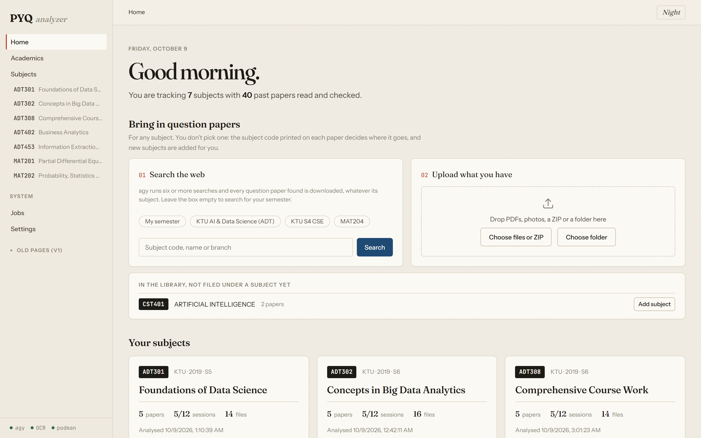

*Figure 1: Home Dashboard displaying enrolled courses, syllabus completion indicators, and direct multi-query web search or folder import actions.*

---

### Course Workspace

The course overview aggregates module structures, paper counts, and learning materials into a unified console.

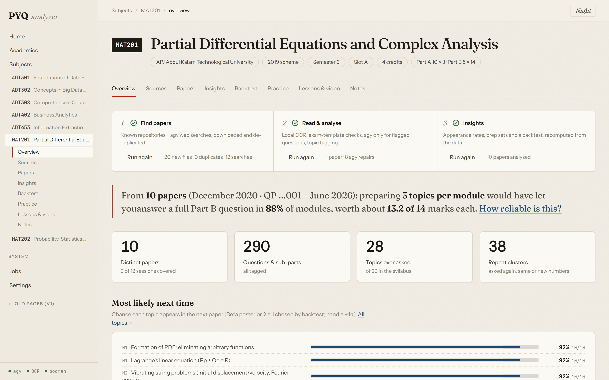

*Figure 2: Course Workspace overview summarizing syllabus breakdown, paper counts, and modular coverage.*

---

### Primary Source Management

The sources console tracks all ingested PDF files, digital archives, lecture presentations, and DSpace harvests.

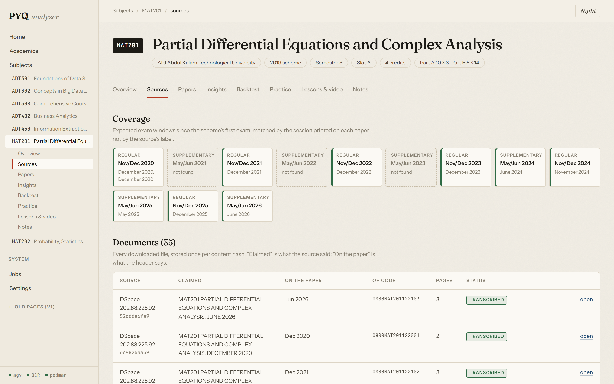

*Figure 3: Sources Console detailing ingested files, acquisition origin, SHA-256 hashes, and extraction states.*

---

### Background Execution Telemetry

Long-running OCR, validation, and analytics jobs run asynchronously with real-time logs streamed via Server-Sent Events.

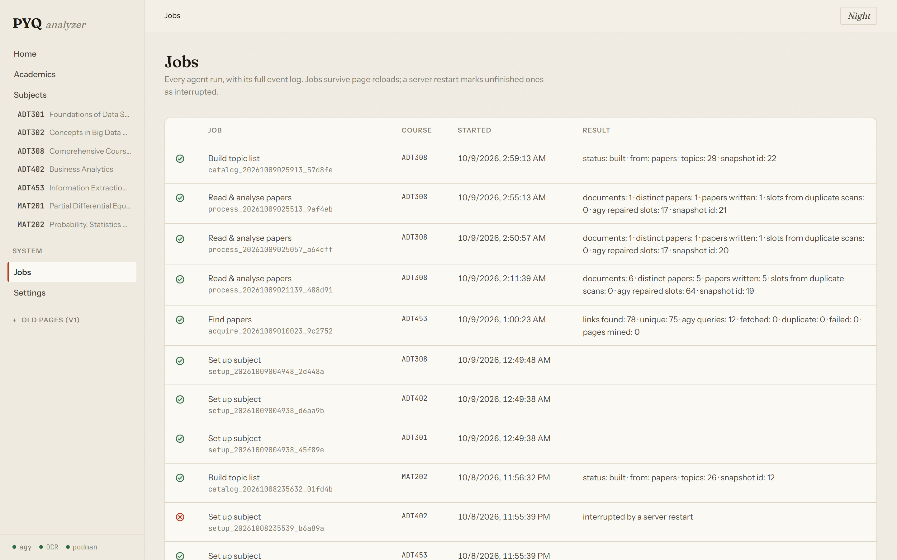

*Figure 4: Jobs Console displaying step execution progress, worker states, and active OCR passes.*

---

### Transcribed Exam Papers (Theory Format)

The paper viewer provides side-by-side inspection of transcribed mathematical notation, marks, cognitive types, and syllabus mappings.

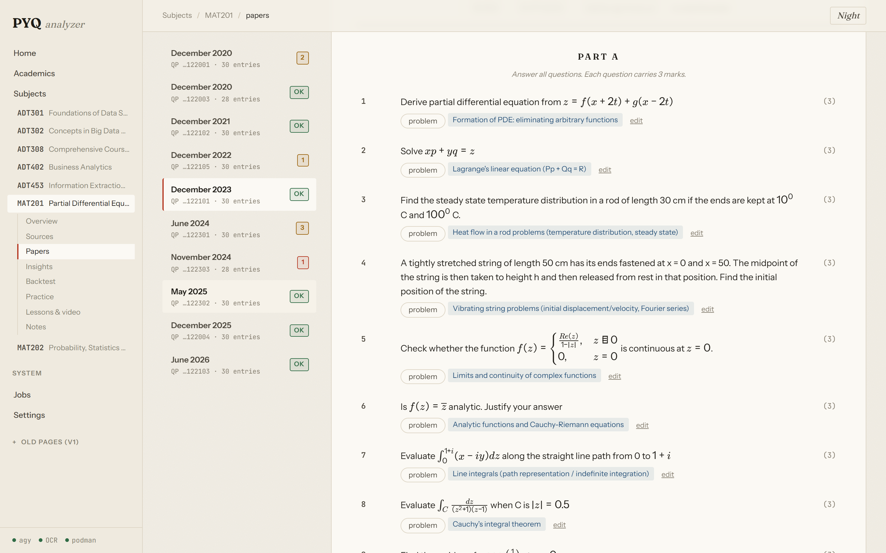

*Figure 5: MAT201 Theory Paper inspection showing OCR-transcribed LaTeX formulas, sub-part marks, topic tagging, and B01–B12 validation tags.*

---

### Transcribed Exam Papers (MCQ Format)

Multiple-choice papers are validated for complete option sets (A through D) and checked for OCR repetition anomalies.

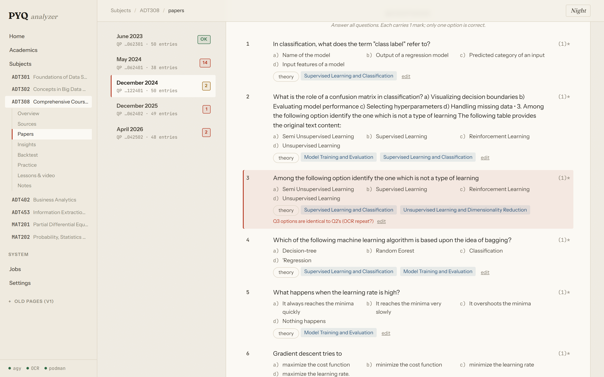

*Figure 6: ADT308 Comprehensive Course Work paper showing 50-MCQ layout, option parsing, and anomaly flags.*

---

### Curriculum Analytics and Topic Heatmaps

Analytics visualizations identify topic weightage trends and historical mark distributions across examination cycles.

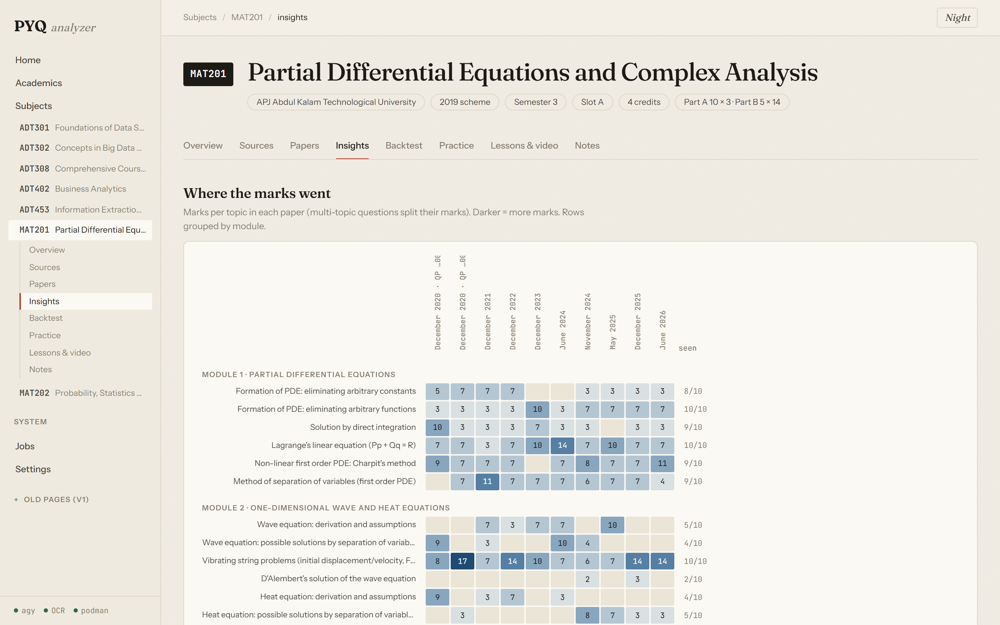

*Figure 7: Topic distribution heatmap detailing mark allocations per topic across past university sessions.*

---

### Rolling-Origin Backtesting

The backtest dashboard evaluates prediction models against held-out papers, comparing empirical forecasts against baseline models.

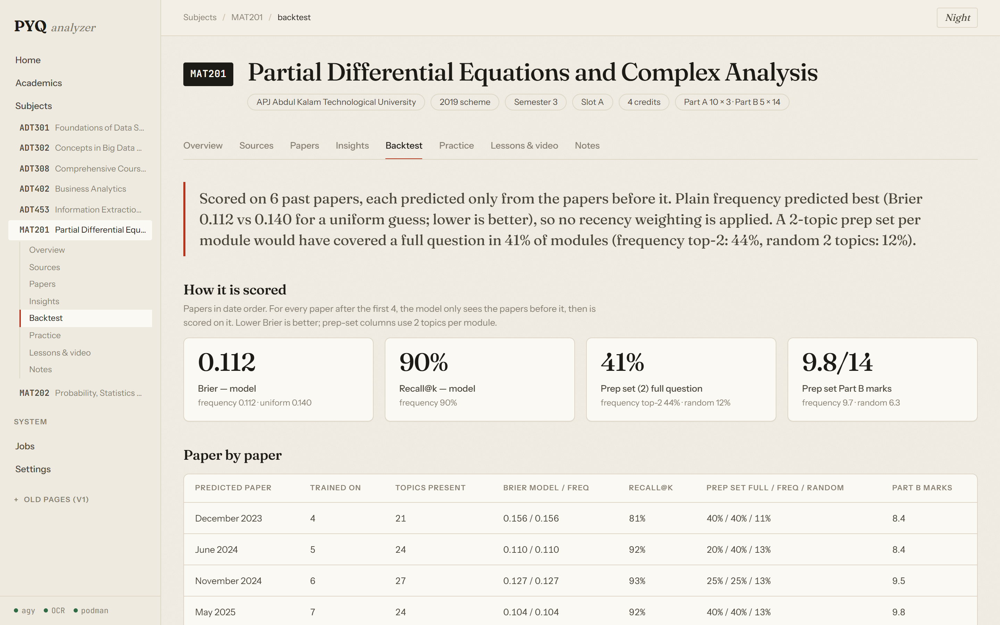

*Figure 8: Backtest interface showing Brier score calibration, top-K recall, and baseline comparisons.*

---

### Adaptive Practice Paper Generator

The practice engine synthesizes balanced mock examination papers based on predicted topic probabilities.

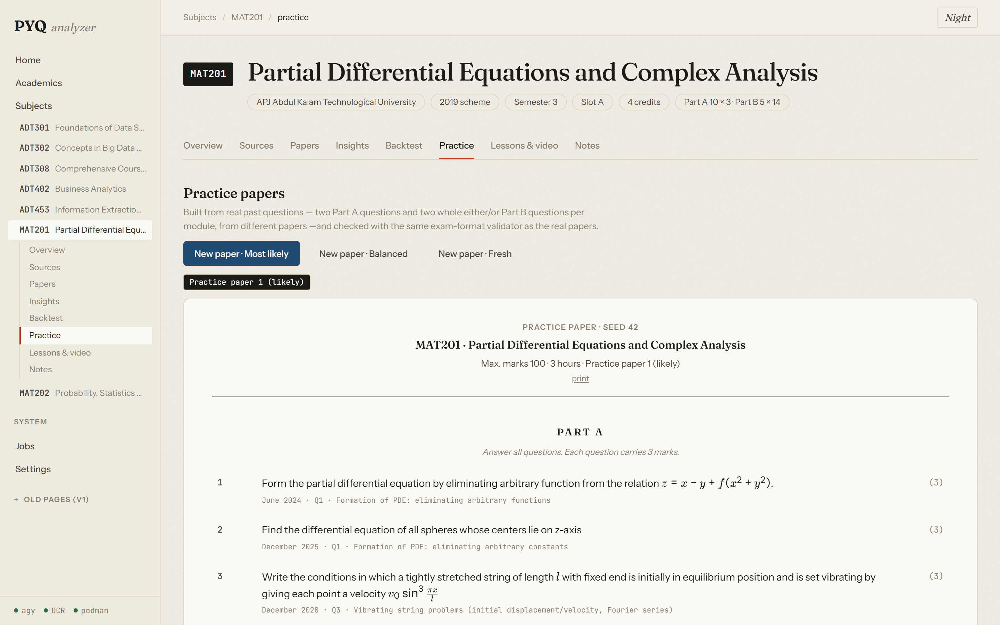

*Figure 9: Practice paper interface displaying synthesized mock examination papers derived from verified past questions.*

---

### Narrated Video Lesson Player

Auto-generated narrated lessons provide slide transitions, synchronized audio narration, and MP4 video exports.

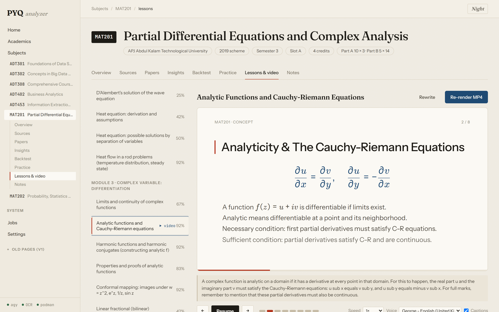

*Figure 10: Narrated lesson player featuring local TTS narration, synchronized captions, and MP4 download functionality.*

---

### Module Study Notes

Structured revision notes distill complex proofs, core equations, and key theory questions for every module.

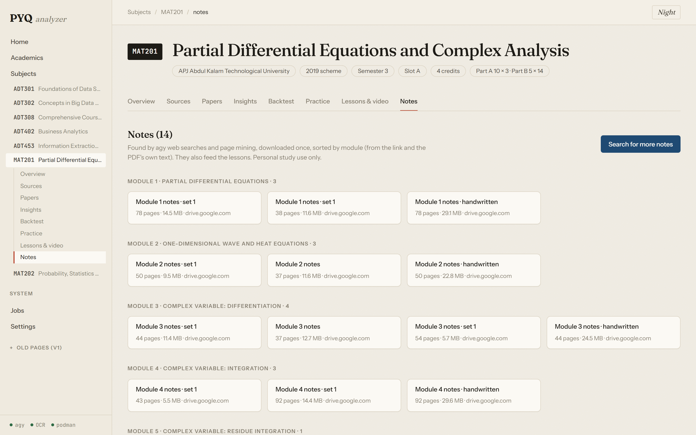

*Figure 11: Modular study notes interface presenting curated reference materials and exam-focused summaries.*

---

## System Requirements and Model Topology

### Hardware Specifications

| Component | Minimum Specification | Recommended Specification |
|---|---|---|
| **CPU** | 4 Cores (x86_64 / Apple Silicon) | 8+ Cores (x86_64 / Apple Silicon) |
| **System Memory** | 8 GB RAM | 16 GB+ RAM |
| **GPU Acceleration** | None (CPU inference via Ollama) | NVIDIA GPU with 4 GB+ VRAM or Apple Metal |
| **Storage** | 10 GB free disk space | 30 GB free SSD disk space |

### Software Dependencies

- **Operating System**: Windows 10/11 (64-bit), Ubuntu 22.04+ LTS, Debian 12+, or macOS 13+ (Ventura).
- **Python**: `>= 3.11` (Python 3.12 managed via `uv` recommended).
- **Node.js**: `>= 18.0` LTS with `npm`.
- **Ollama**: Local model runner ([ollama.com](https://ollama.com)).
- **FFmpeg**: Required for audio normalization and MP4 video lesson export.
- **Antigravity CLI (`agy`)**: Optional; required only for live web search and cloud repair fallback of defective scan slots.

### Default Model Allocations

| Role | Model Identifier | Quantization | Context Window | Hosting |
|---|---|---|---|---|
| **Primary Vision OCR** | `hf.co/sahilchachra/Unlimited-OCR-GGUF:Q4_K_M` | Q4_K_M | 3072 tokens | Local Ollama |
| **Vision OCR Fallback** | `moondream:latest` | Q4_0 | 2048 tokens | Local Ollama |
| **Structuring & Extraction** | `huihui_ai/gemma-4-abliterated:e4b` | Q4_K_M | 4096 tokens | Local Ollama |
| **Syllabus Verification** | `huihui_ai/gemma-4-abliterated:e4b` | Q4_K_M | 4096 tokens | Local Ollama |
| **Text Embeddings** | `nomic-embed-text:latest` | F16 | 2048 tokens | Local Ollama |
| **Cloud Repair Agent** | `gemini-3.8-flash-low` / `gemini-3.8-flash-medium` | Cloud API | Variable | Antigravity `agy` |

---

## Installation Guide

### Automated Installation on Windows

The repository includes a PowerShell installer (`install.ps1`) that provisions missing prerequisites (via `winget` and `astral.sh/uv`), configures Python 3.12 virtual environments, installs npm packages, starts Ollama, and pulls required models.

**Easiest:** double-click **`install.cmd`**, then **`start-app.cmd`** (and **`stop-app.cmd`** to stop). The `.cmd` launchers bypass the PowerShell execution policy and keep the window open, so you can read any message. Setup output is also saved to `install.log`; app logs go to `.run\`. The project can live in any folder or drive: every path is relative to the project folder.

Or open PowerShell (no Administrator needed) and run:

```powershell
powershell -ExecutionPolicy Bypass -File .\install.ps1
```

#### Installer Parameters

| Parameter | Type | Description |
|---|---|---|
| `-SkipModels` | Switch | Skips model downloads (useful for metered connections or pre-cached models). |
| `-WithV1Models` | Switch | Downloads legacy models (`gemma-4-abliterated:e4b`, `moondream:latest`). |
| `-Test` | Switch | Executes the backend test suite upon installation completion. |

Example invocation skipping models:

```powershell
powershell -ExecutionPolicy Bypass -File .\install.ps1 -SkipModels
```

---

### Automated Installation on Linux and macOS

The shell script (`install.sh`) configures dependencies on POSIX platforms:

```bash
chmod +x install.sh
./install.sh
```

#### Installer Options

| Flag | Description |
|---|---|
| `--skip-models` | Bypasses Ollama model download steps. |
| `--with-v1-models` | Pulls secondary LLM models for legacy experimental features. |
| `--test` | Runs `pytest` validation suite immediately after package installation. |

Example invocation with test execution:

```bash
./install.sh --test
```

---

### Manual Step-by-Step Installation

If automated scripts cannot be utilized, configure each layer manually:

#### Step 1: Install Core Tools
1. Install **Python 3.12** and **uv**:
   ```bash
   # Windows (PowerShell)
   powershell -ExecutionPolicy Bypass -Command "irm https://astral.sh/uv/install.ps1 | iex"

   # Linux / macOS
   curl -LsSf https://astral.sh/uv/install.sh | sh
   ```
2. Install **Node.js LTS** (v18 or v20) from [nodejs.org](https://nodejs.org).
3. Install **Ollama** from [ollama.com](https://ollama.com).
4. Install **FFmpeg** via package manager:
   ```bash
   # Windows
   winget install Gyan.FFmpeg

   # Ubuntu / Debian
   sudo apt update && sudo apt install -y ffmpeg

   # macOS
   brew install ffmpeg
   ```

#### Step 2: Download Ollama Models
Ensure Ollama is running (`ollama serve`), then pull the required models:

```bash
ollama pull hf.co/sahilchachra/Unlimited-OCR-GGUF:Q4_K_M
ollama pull nomic-embed-text
```

If utilizing full multi-agent synthesis:

```bash
ollama pull huihui_ai/gemma-4-abliterated:e4b
ollama pull moondream:latest
```

#### Step 3: Backend Setup
From the repository root:

```bash
cd backend

# Create virtual environment with Python 3.12
uv venv .venv --python 3.12

# Activate virtual environment
# Windows (PowerShell):
.venv\Scripts\Activate.ps1
# Linux / macOS:
source .venv/bin/activate

# Install dependencies in editable mode with development packages
uv pip install -e . --extra dev

# Copy default environment configuration
cp .env.example .env
```

#### Step 4: Frontend Setup
From the repository root:

```bash
cd frontend
npm install
```

---

## Running the System

### Option A: Launcher Scripts

#### Windows Launcher (`start.ps1`)

Starts Ollama (if not running), launches the FastAPI backend on port 8010, starts the Vite development server on port 5173, and opens your default browser.

```powershell
# Start application
powershell -ExecutionPolicy Bypass -File .\start.ps1

# Stop running background processes
powershell -ExecutionPolicy Bypass -File .\start.ps1 -Stop

# Start without opening browser
powershell -ExecutionPolicy Bypass -File .\start.ps1 -NoBrowser

# Start on custom backend port
powershell -ExecutionPolicy Bypass -File .\start.ps1 -Port 8020
```

#### Linux / macOS Launcher (`start.sh`)

```bash
chmod +x start.sh

# Start application
./start.sh

# Stop background processes
./start.sh --stop

# Start without browser
./start.sh --no-browser
```

---

### Option B: Manual Execution

#### 1. Start Ollama Service
```bash
ollama serve
```

#### 2. Start Backend API
```bash
cd backend
# Windows:
.venv\Scripts\activate
# Linux/macOS:
source .venv/bin/activate

uvicorn app.main:app --host 127.0.0.1 --port 8010 --reload
```

The interactive OpenAPI documentation will be accessible at `http://127.0.0.1:8010/docs`.

#### 3. Start Frontend Development Server
In a separate terminal:

```bash
cd frontend
npm run dev
```

Access the user interface at `http://localhost:5173`. The Vite server automatically proxies requests matching `/api/*` to `http://127.0.0.1:8010`.

---

## Configuration and Environment Variables

Settings are defined in `backend/app/config.py` using Pydantic Settings and can be overridden via `backend/.env`.

| Environment Variable | Default Value | Description |
|---|---|---|
| `APP_NAME` | `PYQ Analyzer` | Application display title. |
| `DEBUG` | `False` | Verbose debug logging toggle. |
| `DATABASE_URL` | `sqlite+aiosqlite:///backend/pyq_analyzer.db` | Async SQLAlchemy database connection string. |
| `OLLAMA_BASE_URL` | `http://127.0.0.1:11434` | Endpoint for the Ollama inference server. |
| `OLLAMA_OCR_MODEL` | `hf.co/sahilchachra/Unlimited-OCR-GGUF:Q4_K_M` | Primary vision OCR GGUF model. |
| `OLLAMA_VISION_FALLBACK_MODEL` | `moondream:latest` | Lightweight image inspection fallback model. |
| `EMBEDDING_MODEL` | `nomic-embed-text:latest` | Model identifier for ChromaDB vector embeddings. |
| `EXTRACTION_CHAIN` | `["text_layer", "local_ocr", "agy"]` | Priority ordering for document text extraction. |
| `OCR_NUM_CTX` | `3072` | KV context window allocated to local vision OCR. |
| `OCR_RENDER_SCALE` | `2.0` | PDF page rasterization scale multiplier (300 DPI). |
| `AGY_BIN` | `agy` | Executable path for the Antigravity cloud CLI tool. |
| `AGY_ENABLED` | `True` | Enables cloud-based web search and slot repair. |
| `AGY_CONCURRENCY` | `3` | Maximum concurrent processes dispatched to `agy`. |
| `DSPACE_SOURCES` | `["http://202.88.225.92/xmlui"]` | Target DSpace repository base URLs for paper acquisition. |
| `MASTERY_ALPHA` | `0.60` | Exponential moving average smoothing factor for student mastery. |

---

## API Route Specification

The FastAPI backend exposes RESTful endpoints and Server-Sent Event (SSE) streams under the `/api` namespace:

### Course & Catalog Operations (`/api/courses`)
- `GET /api/courses`: Lists enrolled courses with paper counts, syllabus topic counts, and ingestion completeness.
- `GET /api/courses/{code}`: Fetches course metadata, module definitions, and blueprint configurations.
- `POST /api/courses/catalog/rebuild`: Rebuilds the global curriculum database from syllabus definitions.
- `GET /api/courses/{code}/coverage`: Returns structural question coverage per module.

### Papers & Transcript Management (`/api/papers`)
- `POST /api/papers/upload`: Ingests single PDF or image examination papers.
- `GET /api/papers/{paper_id}`: Retrieves normalized paper representations, questions, and validation logs.
- `GET /api/papers/{paper_id}/transcript`: Returns structured JSON transcript for a paper.
- `POST /api/papers/{paper_id}/validate`: Re-evaluates deterministic validation rules against a transcript.

### Library & Bulk Ingestion (`/api/library`)
- `POST /api/library/upload-archive`: Ingests and unpacks ZIP or TAR archives of past examination papers.
- `POST /api/library/scan-directory`: Reads and classifies files stored in local directories.
- `POST /api/library/acquire`: Initiates asynchronous web search and DSpace repository crawling for a course.

### Pipeline & Background Telemetry (`/api/pipeline` and `/api/jobs`)
- `POST /api/pipeline/run`: Triggers full end-to-end processing across an entire subject bundle.
- `GET /api/pipeline/events/{paper_id}`: Streams live agent progress events via Server-Sent Events (SSE).
- `GET /api/jobs`: Returns status, progress metrics, and execution logs for background tasks.
- `POST /api/jobs/{job_id}/cancel`: Halts active background job execution.

### Curriculum Analytics & Forecasting (`/api/analysis` and `/api/courses/{code}/insights`)
- `GET /api/courses/{code}/insights`: Returns historical mark distributions, topic heatmaps, and appearance frequencies.
- `GET /api/courses/{code}/backtest`: Runs rolling-origin backtests and computes Brier calibration metrics.
- `GET /api/courses/{code}/probability`: Computes Bayesian posterior probabilities for the upcoming examination session.

### Study Layer & Practice Generator (`/api/study`)
- `POST /api/study/practice/generate`: Synthesizes mock examination papers from verified historical questions.
- `POST /api/study/lessons/generate`: Produces narrated lesson scripts, audio tracks, and MP4 video exports.
- `GET /api/study/notes/{course_code}/{module_no}`: Retrieves structured module study notes and core proofs.

### Student Profile & Academics (`/api/profile`)
- `POST /api/profile/grade-card/upload`: Parses university grade-card PDFs to extract CGPA, SGPA, and registered courses.
- `GET /api/profile/status`: Returns student academic status, semester milestones, and identified backlogs.

---

## Testing and Verification

Backend testing suites validate parsers, deterministic blueprint rules, statistical models, and extraction layers:

```bash
cd backend

# Run the complete test suite
uv run pytest -q

# Run exam template validation tests
uv run pytest tests/test_templates.py

# Run batch processing and boundary tests
python test_batch_and_boundary.py

# Run OCR strip slicing and pipeline tests
python test_ocr_pipeline.py
```

### Test Coverage Highlights
- **`tests/test_templates.py`**: Verifies Rules B01 through B12, slot inferencing, Part B mark summations, and deduplication logic against ground-truth exam fixtures.
- **`test_batch_and_boundary.py`**: Validates document partitioning across merged multi-exam bundles.
- **`test_ocr_pipeline.py`**: Validates watermark neutralization, whitespace strip slicing, and KV-cache constraints.

---

## Empirical Pilot Results

The architecture was evaluated in an interim pilot study on APJ Abdul Kalam Technological University (KTU) engineering courses.

### Dataset Overview
- **Analyzed Subjects**: 7 engineering courses (including `MAT201` Partial Differential Equations and Complex Analysis, `MAT202` Discrete Mathematics, and 5 `ADT` Artificial Intelligence and Data Science specializations).
- **Collected Materials**: 127 examination papers and reference documents.
- **Processed Exam Papers**: 41 distinct semester papers.
- **Transcribed and Validated Questions**: 1,252 individual examination questions.
- **Cataloged Topics**: 163 syllabus-mapped topics across engineering modules.

### Predictive Calibration on Held-Out Papers (MAT201 Pilot)

Models were evaluated across 6 held-out consecutive examination sessions (from Dec 2020 through Jun 2024), fitting parameters strictly on preceding papers:

| Metric | Beta-Posterior Model | Baseline Model | Interpretation |
|---|---|---|---|
| **Brier Score** | **0.112** | 0.140 (Uniform Guess) | Lower is better. Confirms calibrated topic probability rankings over random or uniform estimates. |
| **Topic Recall@K** | **90.0%** | 52.4% (Random Selection) | Successfully anticipates 9 out of 10 assessed topics in upcoming examination sessions. |
| **Part B Choice Score** | **9.9 / 14 Marks** | 6.3 / 14 Marks (Random) | Expected marks obtained in Part B either/or choices when preparing the top 2 ranked topics per module. |

### Technical Observations
1. **Local Vision OCR Behavior**: Local execution averages approximately 30 seconds per page on consumer laptop GPUs. Unchecked full-page recognition on dense layouts occasionally triggers generation loops; horizontal strip slicing (`ocr_strips=3`) and watermark neutralization resolve these anomalies.
2. **Deterministic Blueprint Efficacy**: Rules B01–B12 caught multiple subtle transcription anomalies that bypassed standard LLM JSON parsers, including repeated option fields, mismatched module headings, and source documents containing duplicated printed pages.
3. **Cloud Repair Throttling**: Delegating only defective slots to cloud models achieved complete document integrity (48–50 of 50 questions verified on complex MCQ papers) while minimizing cloud API consumption.

---

## Repository Organization

```
exam-analytics-ai/
├── backend/
│   ├── app/
│   │   ├── agents/          # Agent implementations (OCR, Structuring, Boundary, Evaluation)
│   │   ├── catalog/         # Course catalog databases and syllabus definitions
│   │   ├── models/          # Async SQLAlchemy database models
│   │   ├── routers/         # FastAPI REST and SSE endpoints
│   │   ├── schemas/         # Pydantic validation schemas
│   │   ├── services/        # Subsystem implementations:
│   │   │   ├── acquisition/ # Web search crawlers and DSpace connectors
│   │   │   ├── extraction/  # OCR strip slicers and pypdfium2 wrappers
│   │   │   ├── academics.py # Grade-card parser and student academic profile
│   │   │   ├── agy.py       # Antigravity CLI cloud agent interface
│   │   │   ├── backtest.py  # Rolling-origin backtesting engine
│   │   │   ├── exam_templates.py # Blueprint schemas and Rules B01–B12 validator
│   │   │   ├── insights.py  # Topic occurrence heatmaps and Beta-posterior models
│   │   │   ├── lessons.py   # Narrated lesson generator and FFmpeg video pipeline
│   │   │   ├── notes.py     # Module-wise study notes synthesizer
│   │   │   ├── practice.py  # Mock examination paper generator
│   │   │   └── transcript.py# Question transcript data structures
│   │   ├── config.py        # Centralized Pydantic application settings
│   │   ├── database.py      # Async SQLite session factory
│   │   └── main.py          # FastAPI application factory and lifecycle handlers
│   ├── tests/               # Pytest test cases (templates, parsers, analytics)
│   ├── pyproject.toml       # Backend Python package configuration
│   └── .env.example         # Template environment configuration file
├── frontend/
│   ├── src/
│   │   ├── api/             # Typed API client functions
│   │   ├── components/      # Shared UI component library
│   │   ├── pages/           # Application views and course workspace:
│   │   │   └── v2/          # Current modular workspace:
│   │   │       ├── course/  # Tabbed views (Overview, Sources, Papers, Insights, Backtest, Practice, Lessons, Notes)
│   │   │       ├── AcademicsPage.tsx  # Academic profile and grade-card view
│   │   │       ├── HomePage.tsx       # Course catalog dashboard
│   │   │       └── JobsPage.tsx       # Real-time job execution telemetry
│   │   ├── App.tsx          # Router configuration and global state providers
│   │   └── main.tsx         # React application entry point
│   ├── package.json         # Frontend dependencies (React 19, Vite, TypeScript)
│   └── vite.config.ts       # Vite build setup and /api proxy configuration
├── docs/                    # Technical documentation and Review 1 presentation resources
├── shots/                   # Application interface screenshots
├── install.ps1              # Windows automated setup script
├── install.sh               # Linux and macOS automated setup script
├── start.ps1                # Windows process runner script
├── start.sh                 # Linux and macOS process runner script
├── LICENSE                  # MIT License specification
└── README.md                # Project documentation
```

---

## License

This project is licensed under the terms of the [MIT License](LICENSE).
