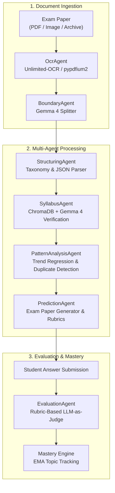

# Exam Analytics AI 

> **Multi-Agent Question Paper Intelligence & Adaptive Testing System**  
> Ingests scanned Previous Year Question papers (PDFs/images), extracts and structures questions via OCR, maps questions to syllabus units, discovers statistical patterns and cognitive duplicates, generates predicted exam papers with rubric grading checklists, evaluates student answers, and maintains per-student mastery maps — **all powered by locally-hosted LLMs via Ollama**.

---

## Key Features

- Multi-Modal OCR Pipeline: Ingests multi-page PDFs, scans, and images via adaptive whitespace banding with `Unlimited-OCR` (GGUF) and `moondream` vision fallback.
- Document Boundary Detection: Identifies merged multi-exam bundles and automatically partitions them into distinct exam sessions using `gemma-4-abliterated:e4b`.
- Question Structuring & Taxonomy: Standardizes questions, parts, subparts, marks, question types, and Bloom's taxonomy levels into clean structured schemas.
- Syllabus Correlation: Indexes course syllabus topics into **ChromaDB** using `nomic-embed-text` embeddings, performing vector similarity retrieval with LLM verification.
- Pattern & Trend Analysis: Computes topic frequency distributions, historical weightage trends, and cognitive duplicate clusters (both verbatim and paraphrased/twisted questions).
- Predictive Exam Generator: Generates high-probability future exam papers respecting syllabus constraints, unit distributions, and trend multipliers, complete with rubric-based evaluation checklists.
- LLM-as-a-Judge Evaluation: Scores student answer submissions against rubric checklists with step-by-step reasoning and actionable feedback.
- Adaptive Mastery Tracking: Updates student topic-level mastery scores using Exponential Moving Average (EMA) to drive personalized revision paths.

---

## Multi-Agent Architecture



### LLM & Model Routing

| Task | Default Local Model | Role |
|---|---|---|
| **OCR & Vision** | `Unlimited-OCR-GGUF:Q4_K_M` | High-precision text extraction from scans |
| **Vision Fallback** | `moondream:latest` | Lightweight image inspection & diagram OCR |
| **Structuring** | `huihui_ai/gemma-4-abliterated:e4b` | JSON normalization & taxonomy tagging |
| **Syllabus Verification** | `huihui_ai/gemma-4-abliterated:e4b` | Unit & topic correlation |
| **Prediction & Rubrics** | `huihui_ai/gemma-4-abliterated:e4b` | Exam paper synthesis with marking criteria |
| **Evaluation** | `huihui_ai/gemma-4-abliterated:e4b` | Automated rubric scoring and feedback |
| **Embeddings** | `nomic-embed-text:latest` | Vector representations in ChromaDB |

---

## Repository Structure

```
exam-analytics-ai/
├── backend/
│   ├── app/
│   │   ├── agents/          # Multi-agent implementations (OCR, Structuring, etc.)
│   │   ├── models/          # SQLAlchemy async database models
│   │   ├── routers/         # FastAPI REST route endpoints
│   │   ├── schemas/         # Pydantic request/response schemas
│   │   ├── services/        # Ollama, ChromaDB, EventBus, Pipeline Runner
│   │   ├── config.py        # Centralized Pydantic application settings
│   │   ├── database.py      # Async database engine & session maker
│   │   └── main.py          # FastAPI application factory & lifespan
│   ├── pyproject.toml       # Backend dependencies & metadata
│   ├── .env.example         # Template configuration file
│   └── test_*.py            # Automated pipeline & boundary test suites
├── frontend/
│   ├── index.html           # SPA entry point
│   ├── package.json         # React 19, TypeScript, Vite dependencies
│   ├── vite.config.ts       # Vite proxy & build configuration
│   └── tsconfig*.json       # TypeScript compiler settings
├── docs/
│   └── PROJECT_REPORT.md    # Comprehensive technical & academic project report
├── PYQ_Analyzer_Project_Report.docx  # Full project report document
└── README.md                # Project documentation
```

---

## Getting Started

### 1. Prerequisites

- **Python**: `>= 3.11`
- **Node.js**: `>= 18.0` (with `npm` or `pnpm`)
- **Ollama**: Installed and running locally ([ollama.com](https://ollama.com))

### 2. Pull Required Models

```bash
# Pull local models via Ollama
ollama pull nomic-embed-text
ollama pull huihui_ai/gemma-4-abliterated:e4b
ollama pull moondream
```

### 3. Backend Setup

```bash
cd backend

# Create and activate virtual environment
python -m venv .venv
# Windows:
.venv\Scripts\activate
# Linux/macOS:
source .venv/bin/activate

# Install dependencies
pip install -e .

# Configure environment variables (optional, defaults work out of the box)
cp .env.example .env

# Run FastAPI server
uvicorn app.main:app --reload --host 127.0.0.1 --port 8000
```

The interactive OpenAPI docs will be available at [http://127.0.0.1:8000/docs](http://127.0.0.1:8000/docs).

### 4. Frontend Setup

```bash
cd frontend

# Install dependencies
npm install

# Start Vite dev server
npm run dev
```

The frontend application will be accessible at [http://localhost:5173](http://localhost:5173).

---

## API Endpoints Overview

| Method | Endpoint | Description |
|---|---|---|
| `POST` | `/api/papers/upload` | Upload PDF/image/ZIP exam paper |
| `POST` | `/api/pipeline/run` | Execute multi-agent processing pipeline |
| `GET` | `/api/pipeline/events/{paper_id}` | WebSocket / SSE live pipeline progress stream |
| `GET` | `/api/questions` | Query structured questions with filters |
| `POST` | `/api/syllabus/upload` | Upload and vectorize syllabus text |
| `GET` | `/api/analysis/{subject_id}` | Retrieve frequency, trend, and duplicate analytics |
| `POST` | `/api/predictions/generate` | Synthesize predicted exam paper with rubrics |
| `POST` | `/api/attempts/evaluate` | Evaluate student answer against rubric checklist |
| `GET` | `/api/mastery/{student_id}` | Fetch student mastery map across syllabus units |

---

## Testing

Execute backend test suites:

```bash
cd backend
python test_batch_and_boundary.py
python test_ocr_pipeline.py
```

---

## Documentation

For full mathematical formulations, agent flowcharts, schema definitions, and academic report context, see [PROJECT_REPORT.md](docs/PROJECT_REPORT.md).

---

## License

Distributed under the [MIT License](LICENSE).
