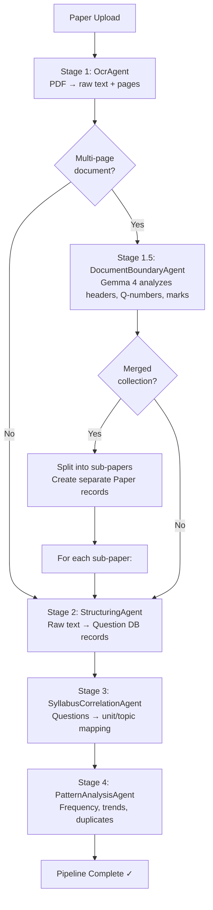
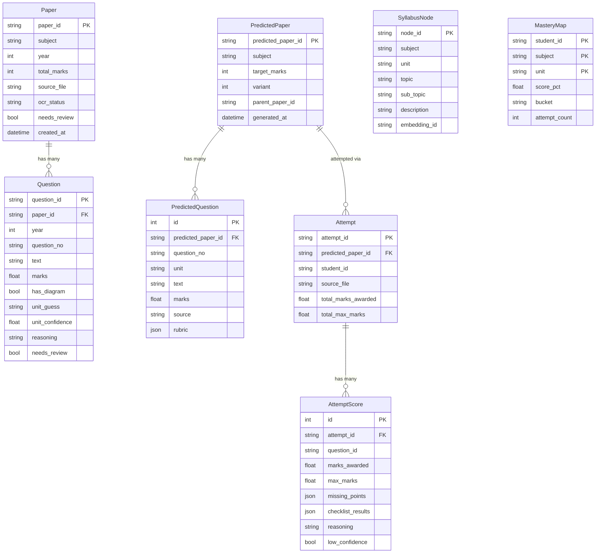

# 📋 PYQ Analyzer — Comprehensive Project Report

> **Project**: PYQ Analyzer — Multi-Agent Question Paper Intelligence & Adaptive Testing System 
---

## 1. Project Overview

PYQ Analyzer is a **full-stack, multi-agent AI system** that ingests scanned Previous Year Question papers (PDFs/images), extracts and structures questions via OCR, maps them to syllabus units, detects statistical patterns and duplicates, generates predicted exam papers with rubric-based grading checklists, evaluates student answer sheets, and maintains a per-student mastery profile — all powered by **locally-hosted LLMs via Ollama**.


---

## 2. Architecture & Technology Stack

### 2.1 Backend

| Layer | Technology | Version / Details |
|---|---|---|
| **Framework** | FastAPI | ≥ 0.115, async, lifespan-based startup |
| **Runtime** | Python | ≥ 3.11 |
| **Database** | SQLite (dev) via aiosqlite; Postgres-ready | SQLAlchemy 2.0 async ORM |
| **Vector Store** | ChromaDB | Persistent client, `nomic-embed-text` embeddings |
| **LLM Inference** | Ollama (local) | Multiple model routing (see §3.2) |
| **Task Queue** | Celery + Redis (configured, not yet wired) | Redis for pub/sub pipeline events |
| **OCR** | Unlimited-OCR (GGUF via Ollama) + pypdfium2 | Adaptive banding, native text fallback |
| **Data Science** | NumPy, scikit-learn, statsmodels, pandas | Trend regression, similarity matrices |
| **Reporting** | WeasyPrint, Matplotlib, Seaborn | PDF report generation (deps installed) |
| **Image Processing** | Pillow, OpenCV (headless) | Whitespace cropping, preprocessing |

### 2.2 Frontend

| Layer | Technology | Version |
|---|---|---|
| **Framework** | React 19 + TypeScript 6 | Vite 8.3 |
| **State Management** | Zustand 5 | Lightweight store |
| **Routing** | React Router DOM 7 | SPA routing |
| **HTTP Client** | Axios 1.20 | API communication |
| **Charting** | Recharts 3.10 + D3 7.9 | Data visualization |
| **Linting** | Oxlint 1.81 | Fast Rust-based linter |

> [!IMPORTANT]
> The frontend has been **scaffolded** (Vite + React template initialized, dependencies installed, `dist/` built) but contains **no application source code** yet — the `src/` directory does not exist. All backend APIs are fully implemented and ready for frontend integration.

### 2.3 Dev-Ops & Configuration

- **Config Management**: Pydantic Settings with `.env` file support ([config.py](file:///d:/ME/B.Tech/s7/SQPP/PYQ%20Analyzer/backend/app/config.py))
- **CORS**: Pre-configured for `localhost:5173` (Vite dev server)
- **API Proxy**: Vite proxies `/api/*` and `/uploads/*` to FastAPI at `127.0.0.1:8000`
- **Static File Serving**: `/uploads`, `/assets`, `/reports` mounted via FastAPI

---

## 3. Multi-Agent Pipeline Architecture

### 3.1 Agent Hierarchy

All agents inherit from [`BaseAgent`](file:///d:/ME/B.Tech/s7/SQPP/PYQ%20Analyzer/backend/app/agents/base.py) which provides:
- Async `run(**kwargs) → dict` contract
- Redis pub/sub + in-memory EventBus progress broadcasting
- Standardized logging per agent

| # | Agent | File | Purpose | LLM Model Used |
|---|---|---|---|---|
| 1 | **OcrAgent** | [ocr.py](file:///d:/ME/B.Tech/s7/SQPP/PYQ%20Analyzer/backend/app/agents/ocr.py) | Extract text from PDFs/images via adaptive banding OCR | `Unlimited-OCR (Q4_K_M)` |
| 1.5 | **DocumentBoundaryAgent** | [boundary_detection.py](file:///d:/ME/B.Tech/s7/SQPP/PYQ%20Analyzer/backend/app/agents/boundary_detection.py) | Detect merged multi-exam PDFs and split boundaries | `gemma-4-abliterated:e4b` |
| 2 | **StructuringAgent** | [structuring.py](file:///d:/ME/B.Tech/s7/SQPP/PYQ%20Analyzer/backend/app/agents/structuring.py) | Parse raw OCR text into structured Question records | `gemma-4-abliterated:e4b` |
| 3 | **SyllabusCorrelationAgent** | [syllabus.py](file:///d:/ME/B.Tech/s7/SQPP/PYQ%20Analyzer/backend/app/agents/syllabus.py) | Map questions to syllabus units via vector search + LLM verification | `gemma-4-abliterated:e4b` |
| 4 | **PatternAnalysisAgent** | [pattern_analysis.py](file:///d:/ME/B.Tech/s7/SQPP/PYQ%20Analyzer/backend/app/agents/pattern_analysis.py) | Statistical frequency, trends, duplicates, cognitive clusters | `nomic-embed-text` (embeddings) |
| 5 | **PredictionAgent** | [prediction.py](file:///d:/ME/B.Tech/s7/SQPP/PYQ%20Analyzer/backend/app/agents/prediction.py) | Generate predicted exam papers with rubric checklists | `gemma-4-abliterated:e4b` |
| 6 | **EvaluationAgent** | [evaluation.py](file:///d:/ME/B.Tech/s7/SQPP/PYQ%20Analyzer/backend/app/agents/evaluation.py) | Grade student answers against rubrics + update mastery | `gemma-4-abliterated:e4b` |

### 3.2 LLM Model Routing

```
┌─────────────────────────────────────────────────────────────┐
│                    Ollama Model Routing                      │
├─────────────────────┬───────────────────────────────────────┤
│ OCR (Vision)        │ Unlimited-OCR-GGUF:Q4_K_M            │
│ Vision Fallback     │ moondream:latest                      │
│ Structuring         │ huihui_ai/gemma-4-abliterated:e4b     │
│ Syllabus            │ huihui_ai/gemma-4-abliterated:e4b     │
│ Prediction          │ huihui_ai/gemma-4-abliterated:e4b     │
│ Evaluation          │ huihui_ai/gemma-4-abliterated:e4b     │
│ Embeddings          │ nomic-embed-text:latest                │
└─────────────────────┴───────────────────────────────────────┘
```

### 3.3 Pipeline Execution Flow

The [`pipeline_runner.py`](file:///d:/ME/B.Tech/s7/SQPP/PYQ%20Analyzer/backend/app/services/pipeline_runner.py) orchestrates the closed-loop pipeline:



---

## 4. Data Models (ORM)

### 4.1 Entity-Relationship Diagram



### 4.2 Model Summary

| Model | Table | Key Columns | Written By |
|---|---|---|---|
| [`Paper`](file:///d:/ME/B.Tech/s7/SQPP/PYQ%20Analyzer/backend/app/models/paper.py#L25-L49) | `papers` | paper_id, subject, year, total_marks, ocr_status | Upload Router, OCR Agent |
| [`Question`](file:///d:/ME/B.Tech/s7/SQPP/PYQ%20Analyzer/backend/app/models/paper.py#L52-L94) | `questions` | question_id, text, marks, unit_guess, unit_confidence | Structuring Agent, Syllabus Agent |
| [`SyllabusNode`](file:///d:/ME/B.Tech/s7/SQPP/PYQ%20Analyzer/backend/app/models/syllabus.py#L16-L44) | `syllabus_nodes` | node_id, unit, topic, sub_topic, description | Syllabus Router |
| [`PredictedPaper`](file:///d:/ME/B.Tech/s7/SQPP/PYQ%20Analyzer/backend/app/models/prediction.py#L17-L39) | `predicted_papers` | predicted_paper_id, subject, variant | Prediction Agent |
| [`PredictedQuestion`](file:///d:/ME/B.Tech/s7/SQPP/PYQ%20Analyzer/backend/app/models/prediction.py#L42-L73) | `predicted_questions` | text, marks, rubric (JSON) | Prediction Agent |
| [`Attempt`](file:///d:/ME/B.Tech/s7/SQPP/PYQ%20Analyzer/backend/app/models/attempt.py#L26-L56) | `attempts` | attempt_id, predicted_paper_id, student_id | Attempts Router |
| [`AttemptScore`](file:///d:/ME/B.Tech/s7/SQPP/PYQ%20Analyzer/backend/app/models/attempt.py#L59-L89) | `attempt_scores` | marks_awarded, missing_points, checklist_results | Evaluation Agent |
| [`MasteryMap`](file:///d:/ME/B.Tech/s7/SQPP/PYQ%20Analyzer/backend/app/models/mastery.py#L16-L39) | `mastery_map` | student_id+subject+unit (composite PK), score_pct, bucket | Evaluation Agent |

---

## 5. API Surface (REST + WebSocket)

### 5.1 Router Endpoints

| Router | Prefix | File | Key Endpoints |
|---|---|---|---|
| **Papers** | `/api/papers` | [papers.py](file:///d:/ME/B.Tech/s7/SQPP/PYQ%20Analyzer/backend/app/routers/papers.py) | `POST /upload`, `GET /`, `GET /{id}`, `POST /{id}/rerun-ocr`, `DELETE /{id}` |
| **Questions** | `/api/questions` | [questions.py](file:///d:/ME/B.Tech/s7/SQPP/PYQ%20Analyzer/backend/app/routers/questions.py) | CRUD for extracted questions |
| **Syllabus** | `/api/syllabus` | [syllabus.py](file:///d:/ME/B.Tech/s7/SQPP/PYQ%20Analyzer/backend/app/routers/syllabus.py) | Manage syllabus tree nodes |
| **Analysis** | `/api/analysis` | [analysis.py](file:///d:/ME/B.Tech/s7/SQPP/PYQ%20Analyzer/backend/app/routers/analysis.py) | Trigger pattern analysis |
| **Predictions** | `/api/predictions` | [predictions.py](file:///d:/ME/B.Tech/s7/SQPP/PYQ%20Analyzer/backend/app/routers/predictions.py) | Generate/list predicted papers |
| **Attempts** | `/api/attempts` | [attempts.py](file:///d:/ME/B.Tech/s7/SQPP/PYQ%20Analyzer/backend/app/routers/attempts.py) | Submit answer sheets for evaluation |
| **Mastery** | `/api/mastery` | [mastery.py](file:///d:/ME/B.Tech/s7/SQPP/PYQ%20Analyzer/backend/app/routers/mastery.py) | Student mastery dashboard data |
| **Pipeline** | `/api/pipeline` | [pipeline.py](file:///d:/ME/B.Tech/s7/SQPP/PYQ%20Analyzer/backend/app/routers/pipeline.py) | `GET /status`, `WS /ws`, `GET /review-queue`, `PATCH /review-queue/{type}/{id}` |
| **Health** | `/api/health` | [main.py](file:///d:/ME/B.Tech/s7/SQPP/PYQ%20Analyzer/backend/app/main.py#L71-L77) | `GET /api/health` |

### 5.2 Real-Time Communication

- **WebSocket**: `ws://localhost:8000/api/pipeline/ws` streams live agent progress events (`agent`, `stage`, `progress %`, `detail`, `timestamp`)
- **Event Bus**: In-memory async pub/sub ([event_bus.py](file:///d:/ME/B.Tech/s7/SQPP/PYQ%20Analyzer/backend/app/services/event_bus.py)) with optional Redis fallback
- **Upload Support**: Multipart file upload for single papers + **ZIP batch upload** with automatic archive extraction and metadata inference

---

## 6. Core Services

### 6.1 Ollama Service ([ollama.py](file:///d:/ME/B.Tech/s7/SQPP/PYQ%20Analyzer/backend/app/services/ollama.py))

Unified async client for all local LLM operations:
- `generate()` — text completion
- `generate_json()` — JSON-structured output with robust substring extraction (strips markdown fences, finds JSON objects/arrays)
- `generate_vision_ocr()` — vision inference with OCR-specialist trigger (`<image>\nDocument parsing.`) and automatic fallback to `moondream`
- `embed()` — vector embedding via `nomic-embed-text` with `/api/embed` → `/api/embeddings` fallback
- `clean_ocr_markdown()` — strips bounding box coordinates, vision hallucinations, maps structural tags

### 6.2 Vector Store ([vector_store.py](file:///d:/ME/B.Tech/s7/SQPP/PYQ%20Analyzer/backend/app/services/vector_store.py))

ChromaDB persistent client managing two collections:
- `syllabus_nodes` — syllabus topic embeddings for semantic matching
- `question_vectors` — question text embeddings for duplicate/similarity detection
- Cosine distance → similarity conversion with proper normalization

### 6.3 Archive Extractor ([archive_extractor.py](file:///d:/ME/B.Tech/s7/SQPP/PYQ%20Analyzer/backend/app/services/archive_extractor.py))

ZIP archive unpacker with:
- **ZipSlip prevention** (path traversal security)
- Filename/directory-based metadata inference (subject, year, session month)
- Supports: `.pdf`, `.png`, `.jpg`, `.jpeg`, `.webp`, `.tiff`

### 6.4 Pipeline Runner ([pipeline_runner.py](file:///d:/ME/B.Tech/s7/SQPP/PYQ%20Analyzer/backend/app/services/pipeline_runner.py))

Orchestrates the 4-stage agent pipeline:
1. OCR → 1.5 Boundary Detection → 2. Structuring → 3. Syllabus Mapping → 4. Pattern Analysis
- Handles merged PDF splitting with automatic sub-paper creation
- Fire-and-forget async background execution via `asyncio.create_task`

---

## 7. Configurable Thresholds & Tuning Parameters

| Parameter | Default | Purpose |
|---|---|---|
| `ocr_confidence_threshold` | 0.60 | Minimum OCR quality before flagging |
| `syllabus_confidence_threshold` | 0.65 | Minimum confidence for auto unit-mapping |
| `syllabus_similarity_top_k` | 5 | Number of candidate syllabus nodes retrieved |
| `duplicate_near_threshold` | 0.92 | Cosine similarity for "near-duplicate" |
| `duplicate_twisted_lower` | 0.80 | Lower bound for "twisted rewording" |
| `prediction_wildcard_pct` | 0.10 | Wildcard question budget in predictions |
| `mastery_alpha` | 0.60 | EMA decay for mastery score updates |
| `mastery_clear_threshold` | 80.0% | Score above which a topic is "clear" |
| `mastery_partial_threshold` | 40.0% | Score above which a topic is "partial" |
| `trend_rising_mult` | 1.25x | Weightage boost for trending topics |
| `trend_declining_mult` | 0.80x | Weightage reduction for declining topics |
| `weak_boost` / `partial_boost` | 0.50 / 0.20 | Mastery-driven prediction weighting |

---

## 8. File Structure

```
PYQ Analyzer/
├── backend/
│   ├── app/
│   │   ├── __init__.py
│   │   ├── main.py                    # FastAPI app factory + CORS + router registration
│   │   ├── config.py                  # Pydantic Settings (50+ tunables)
│   │   ├── database.py                # Async SQLAlchemy engine + session factory
│   │   ├── agents/                    # 7 AI agents + base class
│   │   │   ├── base.py                #   Abstract BaseAgent with progress events
│   │   │   ├── ocr.py                 #   Vision OCR with adaptive banding
│   │   │   ├── boundary_detection.py  #   Merged PDF splitting (Gemma 4)
│   │   │   ├── structuring.py         #   Raw text → Question records
│   │   │   ├── syllabus.py            #   Semantic unit/topic mapping
│   │   │   ├── pattern_analysis.py    #   Statistical trends + duplicate detection
│   │   │   ├── prediction.py          #   Predicted paper generation + rubrics
│   │   │   └── evaluation.py          #   LLM-as-judge grading + mastery update
│   │   ├── models/                    # SQLAlchemy ORM models
│   │   │   ├── paper.py               #   Paper, Question
│   │   │   ├── syllabus.py            #   SyllabusNode
│   │   │   ├── prediction.py          #   PredictedPaper, PredictedQuestion
│   │   │   ├── attempt.py             #   Attempt, AttemptScore
│   │   │   └── mastery.py             #   MasteryMap
│   │   ├── schemas/                   # Pydantic request/response DTOs
│   │   │   ├── paper.py               #   Paper CRUD schemas
│   │   │   └── analysis.py            #   Analysis, prediction, evaluation, mastery schemas
│   │   ├── routers/                   # FastAPI route handlers (8 routers)
│   │   │   ├── papers.py, questions.py, syllabus.py, analysis.py
│   │   │   ├── predictions.py, attempts.py, mastery.py, pipeline.py
│   │   └── services/                  # Infrastructure services
│   │       ├── ollama.py              #   Unified Ollama client (text, vision, embeddings)
│   │       ├── vector_store.py        #   ChromaDB vector search
│   │       ├── event_bus.py           #   Async pub/sub for WebSocket events
│   │       ├── pipeline_runner.py     #   Multi-agent pipeline orchestrator
│   │       └── archive_extractor.py   #   ZIP unpacker with ZipSlip protection
│   ├── pyproject.toml                 # Python project metadata & dependencies
│   ├── pyq_analyzer.db               # SQLite database (98 KB, has data)
│   ├── chroma_data/                   # ChromaDB persistent vector store
│   ├── uploads/                       # Uploaded paper files
│   ├── assets/                        # Extracted image assets (empty)
│   ├── reports/                       # Generated PDF reports (empty)
│   ├── test_ocr_pipeline.py           # Integration tests for Ollama models
│   ├── test_batch_and_boundary.py     # Batch upload + boundary detection tests
│   ├── test_boundary_gemma.py         # Gemma 4 boundary agent tests
│   └── test_no_format.py             # JSON parsing without format constraint tests
├── frontend/
│   ├── index.html                     # SPA entry point
│   ├── package.json                   # React 19 + Vite 8 + Zustand + Recharts + D3
│   ├── vite.config.ts                 # API proxy to FastAPI backend
│   ├── tsconfig.*.json                # TypeScript configuration
│   ├── dist/                          # Built output (favicon, icons, empty index)
│   └── node_modules/                  # Installed dependencies
```

---

## 9. Key Design Decisions

### 9.1 Database-Centric Agent Communication
> Agents communicate exclusively through the database — **no file handoffs** between agents. Each agent reads from and writes back to SQLAlchemy models with idempotent writes keyed by stable IDs.

### 9.2 Local-First LLM Strategy
> All inference runs on **locally-hosted Ollama models**, avoiding cloud API costs and latency. The architecture supports an optional `cloud_llm_provider` fallback (OpenAI, Google, Anthropic) configured but not yet active.

### 9.3 Human-in-the-Loop Review Queue
> Low-confidence results are automatically flagged (`needs_review = True`) across papers, questions, and evaluation scores. A dedicated **review queue API** ([`/api/pipeline/review-queue`](file:///d:/ME/B.Tech/s7/SQPP/PYQ%20Analyzer/backend/app/routers/pipeline.py#L66-L116)) aggregates all flagged items for human approval/override.

### 9.4 Adaptive OCR with Banding
> Tall page scans (>850px) are split into overlapping vertical bands (650px height, 80px overlap) to prevent vision model timeouts. Band texts are merged with line-level deduplication.

### 9.5 Mastery Tracking via Exponential Moving Average
> Student mastery scores use EMA (α=0.60) so recent performance is weighted more heavily. Buckets: **weak** (<40%), **partial** (40-80%), **clear** (≥80%).

---

## 10. Current Status & Observations

### ✅ What's Complete

| Component | Status |
|---|---|
| All 7 backend agents | Fully implemented |
| Database models & migrations | Working (SQLite with data) |
| All 8 REST API routers | Implemented |
| WebSocket pipeline events | Working |
| Ollama service client | Full vision, text, embedding support |
| ChromaDB vector store | Dual collection (syllabus + questions) |
| ZIP batch upload with metadata inference | Working |
| Merged PDF boundary detection & splitting | Working |
| Test suite (4 test files) | OCR, batch, boundary, JSON parsing tests |
| Frontend scaffolding | Vite + React initialized, deps installed |

### ⚠️ What Needs Work

| Item | Details |
|---|---|
| **Frontend application code** | `src/` directory is missing — no React components, pages, or stores exist yet. The entire UI needs to be built. |
| **Celery integration** | Redis/Celery deps are declared in `pyproject.toml` but the pipeline runs via `asyncio.create_task` instead of Celery workers |
| **Report generation** | WeasyPrint, Matplotlib, Seaborn are installed but no report generation logic exists in the codebase |
| **Alembic migrations** | Alembic is a dependency but no migration directory exists; tables are auto-created via `Base.metadata.create_all` |
| **Cloud LLM fallback** | Configuration placeholders exist (`cloud_llm_provider`, `cloud_llm_api_key`) but no cloud integration code |
| **Authentication** | No user auth — `student_id` defaults to "default" |
| **Production deployment** | No Dockerfile, docker-compose, or CI/CD configuration |

---

## 11. Dependency Summary

### Backend (25 production dependencies)

| Category | Packages |
|---|---|
| **Web Framework** | fastapi, uvicorn, python-multipart |
| **Database** | sqlalchemy, alembic, aiosqlite |
| **Validation** | pydantic, pydantic-settings |
| **Task Queue** | celery, redis |
| **Vector/ML** | chromadb, sentence-transformers, scikit-learn, statsmodels, numpy, pandas |
| **OCR/Vision** | pillow, opencv-python-headless, pytesseract, pdf2image, pypdfium2 |
| **Reporting** | weasyprint, matplotlib, seaborn |
| **Networking** | httpx, websockets |

### Frontend (7 production dependencies)

| Package | Purpose |
|---|---|
| react, react-dom | UI framework |
| react-router-dom | Client-side routing |
| zustand | State management |
| axios | HTTP client |
| recharts | Chart components |
| d3 | Advanced data visualization |
